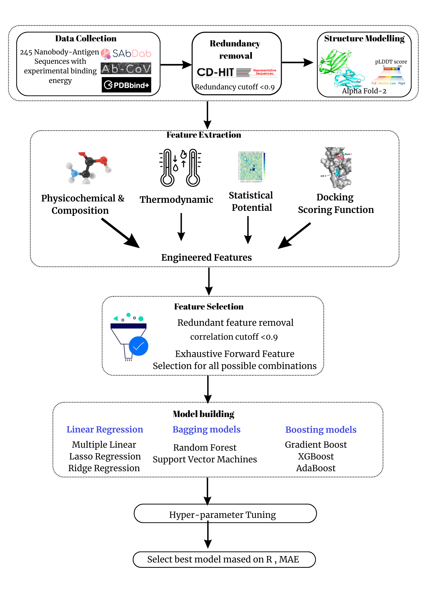

# NanoBEP

Machine learning framework for predicting nanobody–protein binding affinity.


# Workflow


<p align="center">
  
</p>


# Prerequisites

- Git
- Conda (Anaconda or Miniconda)

## Installation

Clone the repository:

```bash
git clone git@github.com:pratibha-manickavasagam/NanoBEP.git
cd NanoBEP
```

Create the Conda environment:

```bash
cd installation
conda env create -f requirements.yml
conda activate nanobep
python --version
```
## Additional Software Requirements

NanoBEP uses **PPDX** for feature extraction. In addition to installing PPDX, several external software packages are required by PPDX and must be installed and configured before running NanoBEP.

The required software includes:

- **PPDX** – Follow the installation instructions provided in the official repository:  
  https://github.com/SimoneCnt/ppdx

* **pyDock3** – Required for protein–protein docking energy calculations.

  Obtain the pyDock3 binary by registering and downloading it from the official pyDock website:

  https://life.bsc.es/pid/pydock/get_pydock.html

  After downloading:

  1. Extract the downloaded archive.
  2. Follow the installation instructions provided in the `README` file included with the pyDock3 package.
  3. Place the extracted `pyDock3` directory inside the `NanoBEP` folder.
  4. Configure the `PATH` as described in the pyDock3 `README` to ensure the `pyDock3` executable is accessible before running NanoBEP.
  * Preffered version for pyDock is 3.2.3 or above.


- **FoldX** – Required for structure-based energy calculations. 

  1. Download and install FoldX from the official website (https://foldxsuite.crg.eu/) .
  2. Ensure the executable is available in your system inside `NanoBEP` folder.
  3. Ensure that `rotabase.txt` is present in FoldX folder.
  4. Use the FoldX version 4 or above.

- **FireDock** – Required for thermodynamic property. 

  1. Download FireDock from the official installation site (https://bioinfo3d.cs.tau.ac.il/FireDock/php.php).
  2. Place the executable folder inside `NanoBEP` folder .
  3. Preferred version of FireDock is 2.0 .


> **Note:** NanoBEP assumes that PPDX, pyDock, FoldX, and FireDock are installed and properly configured before feature extraction is performed.

## Usage

> **Note:** Make sure the path for the additional softwares are added correctly in the `config-ppdx.ini` file present in the `Feature_generation/additional_files` 

# Steps to Predict Binding Energy

1. **Obtain the protein structure.**

   * **If you have only the amino acid sequence:** Generate the 3D structure using **AlphaFold2 (ColabFold)**.
   * **If you already have a PDB structure:** You can use it directly without additional modeling.

2. **Prepare the input files.**

   * Place the PDB structure(s) in the `input` folder.
   * Open `input/input.csv` and enter the required information for each structure, including the **PDB ID** and the corresponding **chain IDs**.

3. **Run the prediction pipeline.**

   * From the project directory, execute:

     ```bash
     chmod +x run.sh
     ./run.sh
     ```

4. **View the results.**

   * After the pipeline completes successfully, the predicted **binding energy (ΔG)** and other generated output files will be available in the `output` folder.


## Documentation

For detailed instructions, visit:

https://github.com/pratibha-manickavasagam/NanoBEP

## Citation

If you use NanoBEP, please cite our work.
